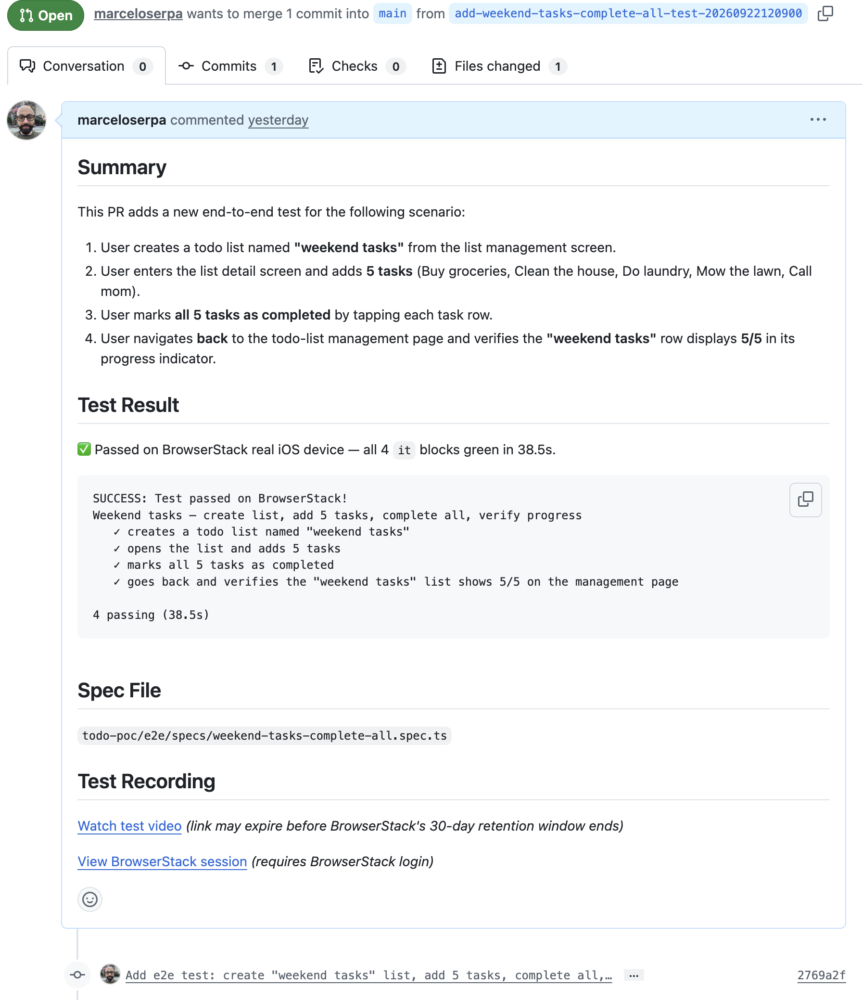

# Strands Agent integration with BrowserStack - PoC

## Running locally

Run the application

```sh
uv run uvicorn agent:app --host 0.0.0.0 --port 8080
```

Test the /ping endpoint

```sh
curl http://localhost:8080/ping
```

Test the /invocations endpoint

```sh
curl -X POST http://localhost:8080/invocations \
  -H "Content-Type: application/json" \
  -d '{
    "input": {"prompt": "What is artificial intelligence?"}
  }'
```


## Running using Docker

Build the image

```sh
docker buildx build --platform linux/arm64 -t e2e-tester-agent:arm64 --load .
```

Test locally with credentials

```sh
docker run --platform linux/arm64 -p 8080:8080 \
  -e AWS_ACCESS_KEY_ID="$AWS_ACCESS_KEY_ID" \
  -e AWS_SECRET_ACCESS_KEY="$AWS_SECRET_ACCESS_KEY" \
  -e AWS_SESSION_TOKEN="$AWS_SESSION_TOKEN" \
  -e AWS_REGION="$AWS_REGION" \
  -e BROWSERSTACK_USERNAME="$BROWSERSTACK_USERNAME" \
  -e BROWSERSTACK_ACCESS_KEY="$BROWSERSTACK_ACCESS_KEY" \
  -e GITHUB_TOKEN="$GITHUB_TOKEN" \
  e2e-tester-agent:arm64
```


## Running in AWS

### Prepare the infrastructure

Create an ECR repository

```sh
aws ecr create-repository --repository-name e2e-tester-agent --region us-east-1
```

Login in to ECR

```sh
aws ecr get-login-password --region us-east-1 | docker login --username AWS --password-stdin $AWS_ACCOUNT_ID.dkr.ecr.us-east-1.amazonaws.com
```

Build the Docker image and push it to ECR

```sh
docker buildx build --platform linux/arm64 -t $AWS_ACCOUNT_ID.dkr.ecr.us-east-1.amazonaws.com/e2e-tester-agent:latest --push .
```

Verify that the image was uploaded successfully

```sh
aws ecr describe-images --repository-name e2e-tester-agent --region us-east-1
```

Create the secrets for BrowserStack and the Github PAT

```sh
aws secretsmanager create-secret --region us-east-1 \
  --name e2e-tester-agent/browserstack \
  --secret-string "{\"username\":\"$BROWSERSTACK_USERNAME\",\"access_key\":\"$BROWSERSTACK_ACCESS_KEY\"}"
```

```sh
aws secretsmanager create-secret --region us-east-1 \
  --name e2e-tester-agent/github \
  --secret-string "{\"token\":\"$GITHUB_TOKEN\"}"
```

Allow AgentRuntimeRole policy to access these credentials:

```sh
aws iam put-role-policy \
  --role-name AgentRuntimeRole \
  --policy-name SecretsManagerAccess \
  --policy-document '{
    "Version": "2012-10-17",
    "Statement": [
      {
        "Effect": "Allow",
        "Action": "secretsmanager:GetSecretValue",
        "Resource": [
          "arn:aws:secretsmanager:us-east-1:<<account id>>:secret:e2e-tester-agent/browserstack-*",
          "arn:aws:secretsmanager:us-east-1:<<account id>>:secret:e2e-tester-agent/github-*"
        ]
      }
    ]
  }'
```

### Execute the Agent

Deploy the agent on AgentRuntime from AgentCore

```sh
uv run deploy_agent.py --aws-account-id=$AWS_ACCOUNT_ID
```

Invoke the agent. The task is fixed to simplify the PoC.

```sh
uv run invoke_agent.py --aws-account-id=$AWS_ACCOUNT_ID --agent-core-suffix={{Get is suffix on AWS console}}
```

The task:
```sh
Scenario: 
1) User create a todo list named weekend tasks. 
2) Enter in the details, and add 5 tasks. 
3)Mark all as completed. 
4) Go back the todo-list management page and should the 'weekend tasks' with 5/5..
```

After completion, a pull request will be opened with the new test spec created.



Here is a example of BrowserStack recording with the new test case implemented:

https://github.com/user-attachments/assets/d3f709f4-ab9f-4ca4-b5c0-1924811d9656
